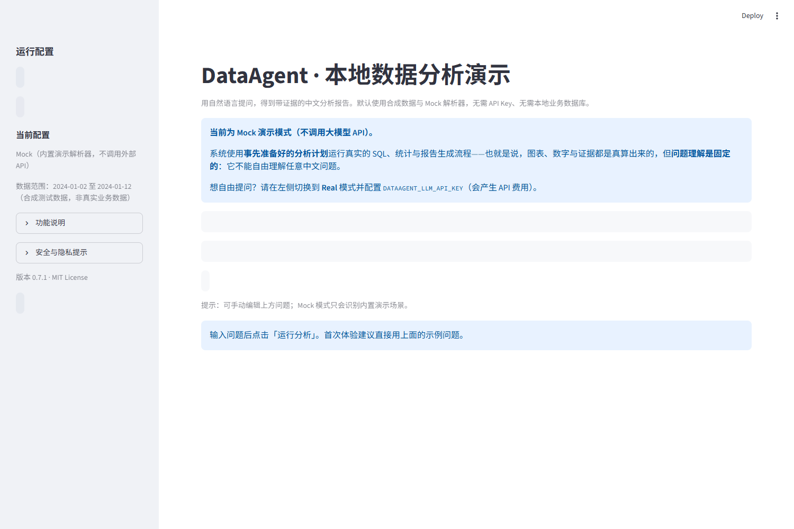
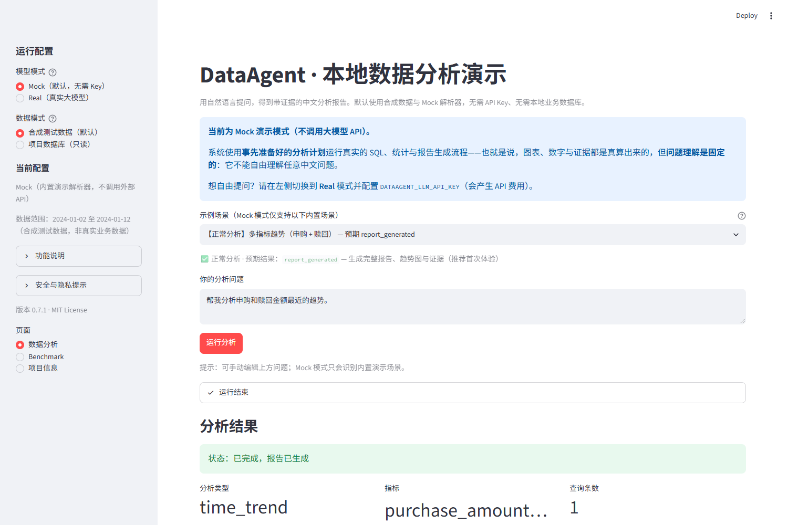
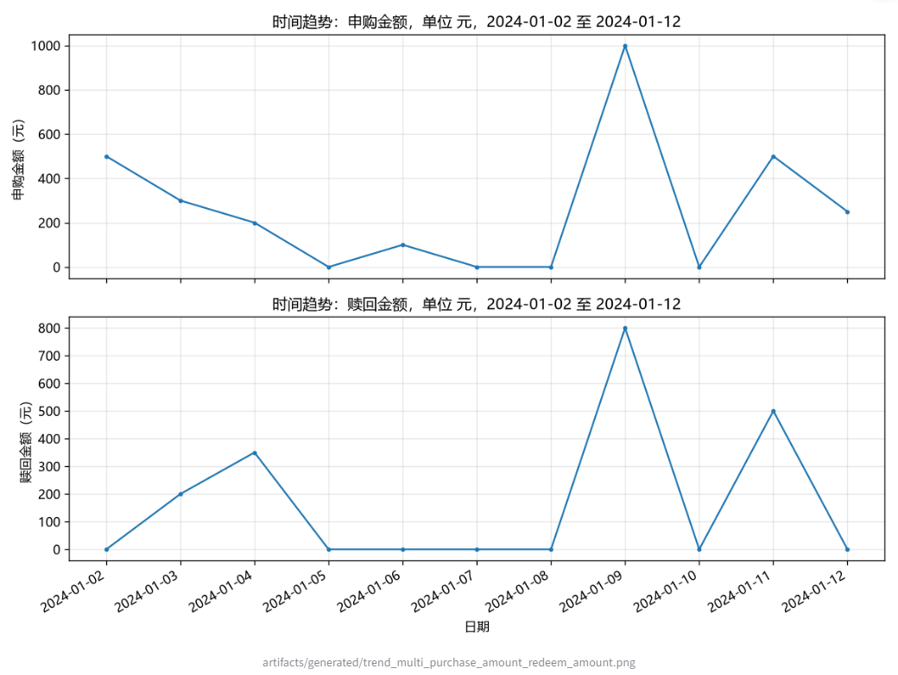
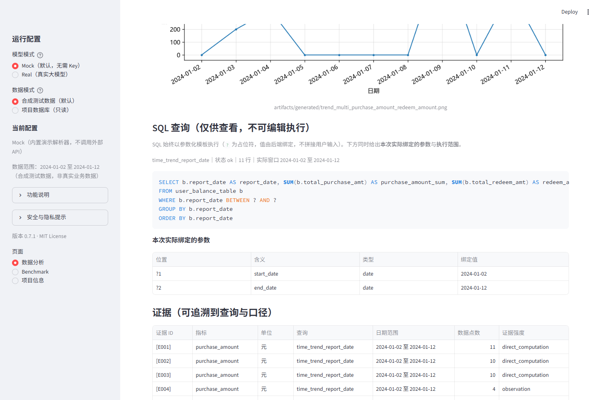
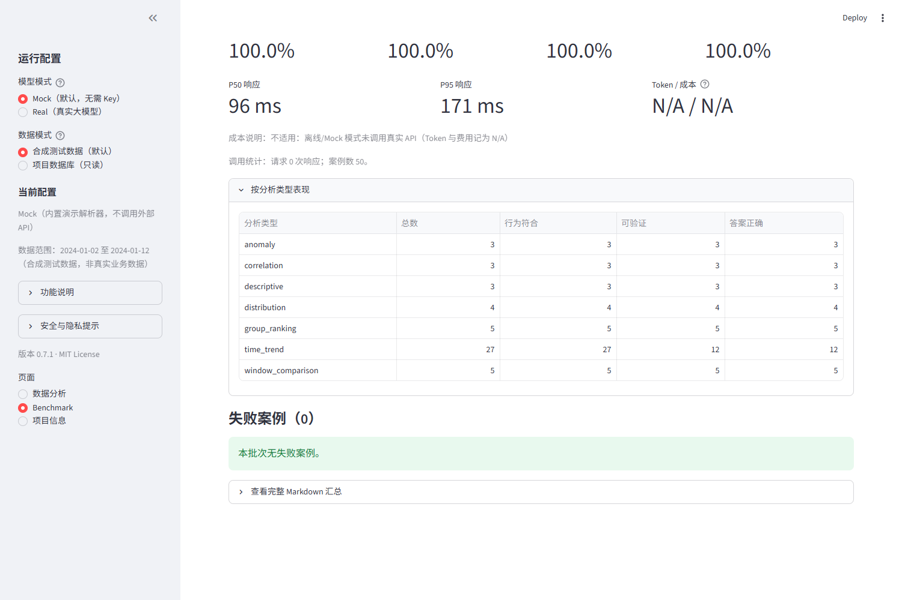
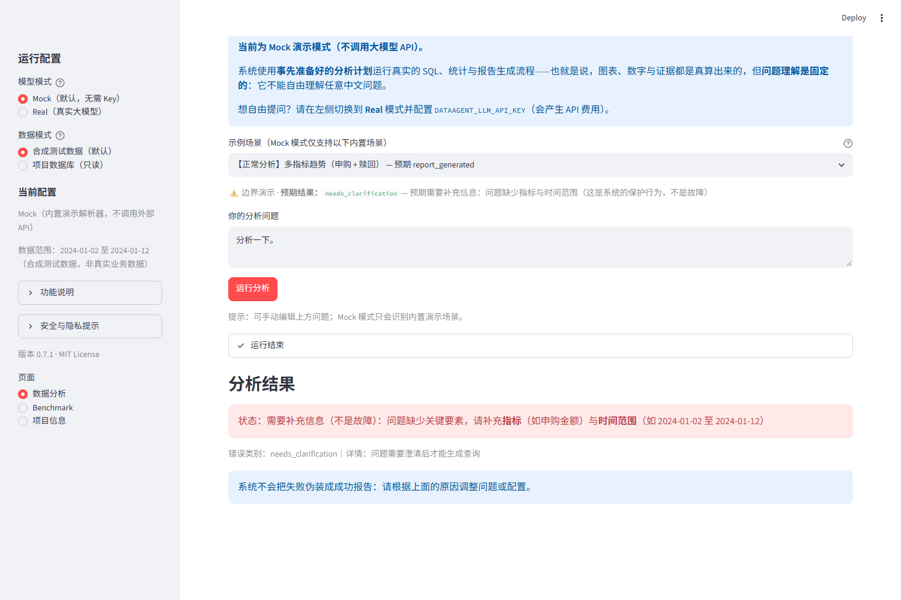
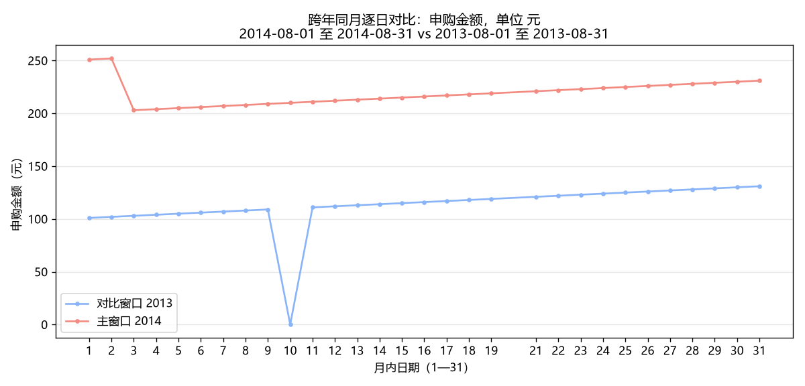
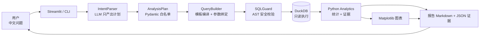

<div align="center">

# DataAgent · 基于大模型与受控 SQL 的数据分析 Agent

**中文提问 → 结构化分析计划 → 安全 SQL → 统计与图表 → 带证据的中文报告**

[](https://www.python.org/)
[](LICENSE)
[-blue.svg)](.github/workflows/ci.yml)

</div>

---

## 1. 这是什么

DataAgent 是一个**基于大模型 + 受约束执行器**的数据分析 Agent：用户用中文提出业务问题，
系统把问题解析成结构化 `AnalysisPlan`，再由**确定性代码**编译成参数化 SQL，经过 AST 级安全校验后
在 DuckDB 上**只读**执行，最后用 Python 完成统计、绘图，并输出**每条结论都能追溯到证据**的中文报告。

它要解决的真问题不是"让模型写 SQL"，而是：

| 常见做法的问题 | DataAgent 的处理 |
|---|---|
| 模型自由生成 SQL，可能越权、注入、扫全表 | SQL 由**封闭模板**编译，模型只产出计划；执行前经 `SQLGuard` AST 校验 |
| 口径随问法漂移，结果无法复核 | 指标/维度/操作走**白名单目录**，口径写死在代码里 |
| 模型"编"合理数字 | 数字全部来自 DuckDB 查询 + Python 计算，报告带 `[E00x]` 证据 ID |
| 失败被包装成成功 | 澄清、拒绝、数据不足、不可比较等**显式状态**，失败关闭（fail-closed） |

**适用场景**：资金流/收益率/用户规模等周期性业务分析；需要**可审计输出**的探索性分析；
作为"LLM + 受约束执行器"架构的工程参考实现。

**不适用**：实时流处理、多用户并发服务、公网部署（见[第 12 节](#12-项目限制后续方向与许可证)）。

> 界面部分是**本地单用户 Streamlit 演示**：无鉴权、无会话隔离、无限流，不适合公网多人使用。

---

## 2. 效果展示

> 全部截图来自 **Mock 模式**（内置演示场景），使用人工构造的合成测试样本，不含任何 API Key 与真实业务数据。

| 首页（提问与配置） | 报告核心结论 |
|---|---|
|  |  |

| 分析图表 | SQL 参数与证据表 |
|---|---|
|  |  |

| Benchmark 质量面板 | 边界演示（预期澄清） |
|---|---|
|  |  |

**跨年同月逐日对比**（按月内日期 1—31 对齐，缺失日断开、不补零）：



---

## 3. 核心功能

| 能力 | 说明 |
|---|---|
| 自然语言 → `AnalysisPlan` | LLM 只输出结构化计划（Pydantic `extra="forbid"`），无法输出 SQL |
| 指标白名单 | 8 个指标（申购/赎回/净流入/收益率/SHIBOR/用户数等），口径写在代码里 |
| 维度与分析类型白名单 | 5 个维度（日期/城市/性别/星座）、7 类分析（趋势/窗口比较/排名/分布/异常/相关/汇总） |
| `SQLGuard` | SQLGlot AST 校验：单条只读 SELECT、表白名单、函数白名单、禁 `SELECT *`、用户级数据保护、维度必须 GROUP BY、列-表绑定 |
| 只读 DuckDB | 连接始终只读，外部文件访问关闭，行数上限 + 超时取消 + 审计 |
| 确定性统计 | Python 完成全部统计（稳健 MAD、Pearson/Spearman、排名占比…） |
| 图表 | Matplotlib（中文优先，缺字体自动英文回退）：趋势、排名、异常、相关、窗口对比、跨年双折线 |
| 证据化报告 | 14 节 Markdown + JSON 证据（`[E00x]` 双向对应），可下载 |
| 跨年同月逐日对比 | 按月内日期对齐两年同月，逐日差额/同比 + 双折线图 |
| Streamlit 界面 | **本地单用户** Streamlit 演示（默认 Mock + 合成数据，**无需 API Key**） |
| Benchmark 与测试 | 50 题离线评测 + 独立标准答案复算 + 千余项自动化测试 |

---

## 4. 系统架构



四个关键设计：

1. **LLM 只负责"理解"**：输出受 Schema 约束的计划，**不接触 SQL 字符串**，无法指定表达式；
2. **SQL 执行前必过校验**：模板编译 + AST 白名单双层；执行层再限制只读、限额、超时；
3. **数字来自数据库与 Python**：模型不参与任何计算，报告里的每个数字都有证据条目；
4. **证据与结论绑定**：结论引用 `[E00x]`，JSON 证据可独立复核；叙述层校验不通过时整段回退确定性文本。

---

## 5. 数据集说明

仓库随附**经授权发布的非真实业务演示数据，已进行脱敏改造，仅用于技术演示、研究与学习。**

- **数据形态**：`demo_data/*.parquet`（约 29 MB，ZSTD 压缩）+ 一键建库脚本 → 本地 DuckDB；
- **覆盖范围**：资金明细 2013-07-01 ~ 2014-08-31（427 天无缺失）；SHIBOR 2013-07-01 ~ 2014-08-29（仅工作日）；日收益率同资金表覆盖；
- **规模**：资金明细 2,840,421 行；用户画像 28,041 行；日收益率 427 行；SHIBOR 294 行。

| 表 | 含义 | 关键字段 |
|---|---|---|
| `user_balance_table` | 用户每日资金余额与变动 | `user_id`、`report_date`、`total_purchase_amt`、`total_redeem_amt`、`consume_amt`、`transfer_amt`、`direct_purchase_amt`、`share_amt`、`tBalance` |
| `user_profile_table` | 用户静态画像 | `user_id`、`sex`、`city`（数字编码，无名称映射）、`constellation` |
| `mfd_day_share_interest` | 基金日收益率 | `mfd_date`、`mfd_daily_yield`、`mfd_7daily_yield` |
| `mfd_bank_shibor` | SHIBOR 利率 | `mfd_date` + 期限列 `Interest_O_N / 1W / 2W / 1M / 3M / 6M / 9M / 1Y` |

**指标口径**（写死在 `src/dataagent/metric_catalog.py`）：

- 申购金额 = 直接购买 + 收益再投（**资金流口径，不是商品销售额**）
- 赎回金额 = 消费 + 转出（资金流口径）
- 净资金流入 = SUM(申购) − SUM(赎回)
- 每日收益率 / 七日年化：原值序列（不做跨行汇总）
- SHIBOR：指定期限的原值序列（期限由参数 `term` 指定）
- 用户数：静态画像去重总人数 / 指定窗口内出现过资金记录的去重用户数

**脱敏与使用限制**：

- `user_id` 已用**稳定哈希重编号**，与原始数据不可对应；聚合分析不受影响；
- 金额**未做缩放**，保持业务恒等式（总赎回 = 消费 + 转出 等）与既有核对基准；
- 数据不代表任何主体的真实经营情况，不得用于商业决策或对外披露；
- 详见 [`docs/data_sources.md`](docs/data_sources.md)（含逐文件 SHA-256）。

> **概念区分（易混淆）**：① **Mock vs Real** 指模型模式——Mock 用内置演示计划（不调用大模型），
> Real 用真实 LLM 理解问题；② **Synthetic vs 演示数据库**指数据模式——Synthetic 是人工构造的小样本
> 测试数据（Mock 场景使用，**非真实业务数据**），演示数据库是仓库随附的**经授权脱敏的非真实业务演示数据**
> （由 `demo_data/*.parquet` 离线构建）。两者均非真实业务运行数据。详见 [`docs/data_sources.md`](docs/data_sources.md)。

---
## 6. 配置自己的 DeepSeek API Key（其他兼容openai的apikey也可以，将对应的url与model更换即可）（此处可以不配置，或在启动streamlit之前配置即可，如果不配置的情况下启动agent仅能使用mock模块）

> Key **只从进程环境变量读取**，项目不读取 `.env`，也**永不保存**你的 Key。

```powershell
# 安全输入：Key 不进入命令历史、不回显（兼容 PowerShell 5.1 与 7）
$secure = Read-Host -AsSecureString "请输入 API Key"
$env:DATAAGENT_LLM_API_KEY = [System.Net.NetworkCredential]::new("", $secure).Password
$env:DATAAGENT_LLM_BASE_URL = "https://api.deepseek.com"
$env:DATAAGENT_LLM_MODEL = "deepseek-flash"

# 自查（只显示是否已设置，不打印值）
if ($env:DATAAGENT_LLM_API_KEY) { "KEY: 已设置" } else { "KEY: 未设置" }
```

然后重启 Streamlit，在侧边栏选择 **模型模式 = Real**、**数据模式 = 项目自带演示数据库**。

**费用提示**：真实模式按服务商计费；正常每个问题 1 次解析调用，**若模型输出不合规会追加一次
Schema 修复重试**（可能额外计费）；叙述层默认关闭。

---
## 7. Quick Start（如果已经clone项目且安装过依赖时，每次在根目录下创建虚拟环境（7.1.2步）后直接启动（7.3步）即可）

> 目标：克隆后**无需自备数据**，装好依赖即可在本地分析项目附带的数据。

### 7.1 克隆与准备环境

```powershell
# 1) 克隆
git clone https://github.com/bbc807198/dataagent.git
cd dataagent

# 2) 创建虚拟环境（Windows PowerShell）
python -m venv .venv
.\.venv\Scripts\Activate.ps1

# 3) 安装依赖（命令行 + 开发测试 + Web 界面）
python -m pip install --upgrade pip
python -m pip install -e ".[dev,web]"
#    · 只做命令行 / 开发测试（不使用网页界面）可只装：pip install -e ".[dev]"
#    · 需要 Streamlit 网页界面（下文 6.x）必须含 web：pip install -e ".[dev,web]"
```

其他环境（macOS / Linux）：

```bash
python3 -m venv .venv && source .venv/bin/activate
python -m pip install --upgrade pip
python -m pip install -e ".[dev,web]"   # 只做命令行/测试可改用 ".[dev]"
```

### 7.2 构建演示数据库（离线，使用仓库自带数据）

```powershell
python scripts\build_demo_db.py --verify
```

输出示例：

```
[OK] user_balance_table.parquet
...
已构建：data/processed/dataagent_demo.duckdb（60.0 MB）
  user_balance_table        2,840,421 行
  ...
  数据覆盖：2013-07-01 ~ 2014-08-31
```

### 7.3 启动界面

```powershell
python -m streamlit run app.py
```

浏览器打开 <http://localhost:8501>。**无需 API Key**：默认 Mock 模式可直接运行内置演示；
配置自己的 Key 后（见下一节）即可用 **Real + 项目自带演示数据库**自由提问。

### 7.4 命令行同样可用

```powershell
# 无 Key 的演示（8 个内置场景）
python scripts\demo_agent.py

# 单个示例（Mock 只识别内置场景，需精确匹配）
python scripts\demo_agent.py --question "各城市申购金额排名。"

# 真实模型 + 自带演示数据库（单次调用，费用可控；需先配置 API Key）
python scripts\demo_agent.py --real --project-db --question "分析 2014 年 8 月每天的申购和赎回趋势"
```

> ⚠️ 只加 `--real` 会依次运行**全部 8 个内置场景**（每个场景一次模型调用）；
> 验证单个问题请始终带 `--question`。


### 7.5 Mock 内置演示场景（无 Key 体验）

Mock 模式使用**事先准备好的分析计划**（不能自由理解任意问题）。共 8 个场景：

| 分类 | 场景 | 问题 | 预期结果 |
|---|---|---|---|
| 正常分析 | 多指标趋势（申购 + 赎回） | 帮我分析申购和赎回金额最近的趋势。 | `report_generated`（报告 + 图表 + 证据） |
| 正常分析 | 城市净资金流入窗口对比 | 比较最近几天和之前几天各城市的净资金流入。 | `report_generated` |
| 正常分析 | 各城市申购金额排名 | 各城市申购金额排名。 | `report_generated` |
| 正常分析 | 申购金额异常识别（MAD） | 申购金额有没有异常日期？ | `report_generated` |
| 正常分析 | 观察期申购金额汇总 | 观察期内申购金额的总体情况。 | `report_generated` |
| 边界演示 | 不支持的指标（销售额） | 帮我分析销售额的变化。 | **预期** `unsupported_metric`（拒绝） |
| 边界演示 | 需要澄清 | 分析一下。 | **预期** `needs_clarification`（追问） |
| 边界演示 | 数据不足（单日趋势） | 分析 2024-01-02 当天的申购金额趋势。 | **预期** `insufficient_data` |

命令行演示会依次运行全部 8 个场景；Web 页面默认选中第一个正常分析场景。

---


## 8. 数据分析示例（均已在自带数据上实测）

| # | 分析目标 | 问题 | 指标 | 日期范围 | 分析类型 | 输出图表 |
|---|---|---|---|---|---|---|
| 1 | 每日申购与赎回走势 | `分析 2014 年 8 月每天的申购和赎回趋势` | 申购金额、赎回金额 | 2014-08-01 ~ 2014-08-31 | `time_trend` | 双指标折线 |
| 2 | 资金净流入规模 | `统计 2014 年 8 月的资金净流入` | 净资金流入 | 2014-08-01 ~ 2014-08-31 | `descriptive` | 汇总（无趋势图） |
| 3 | 两窗口对比 | `比较 2014 年 8 月和 2014 年 7 月各城市的申购金额` | 申购金额 | 2014-08 vs 2014-07 | `window_comparison` | 窗口对比条形图 |
| 4 | 城市排名 | `各城市申购金额排名` | 申购金额 | 全量（可指定区间） | `group_ranking` | 排名条形图 |
| 5 | **跨年同月逐日同比** | `帮我分析2013年8月每天与2014年8月每天的资金申购对比` | 申购金额 | 2014-08 vs 2013-08 | `window_comparison`（`day_of_month`） | **双折线图** |
| 6 | 收益率变化 | `分析 2014 年 8 月的每日收益率变化` | 每日收益率 | 2014-08-01 ~ 2014-08-31 | `time_trend` | 折线 |

> 能力边界：问句必须落在指标目录与分析类型白名单内（例如"销售额"会被明确拒绝，因为没有该指标口径）。

> **示例报告**（合成数据、Mock 模式，点击可直接阅读）：[跨年同月逐日对比](examples/cross_year_daily_comparison_report.md) · [合成演示报告](examples/synthetic_demo_report.md)。两份示例均在页首标注 `mock`（模型模式）与 `synthetic`（数据模式）——合成测试数据，非真实业务数据。

---

## 9. Benchmark 与结果

**离线 Benchmark（50 题：35 个有效问题 + 15 个负面/边界问题）**

| 指标 | 结果 |
|---|---|
| 执行成功率 | **100%**（35/35） |
| 答案正确率 | **100%**（35/35，标准答案分母事前固定） |
| 行为正确率 | **100%**（50/50） |
| 正确拒绝率 | **100%**（15/15），误拒绝 **0** |
| 响应时间 | P50 ≈ 113 ms / P95 ≈ 240 ms（本地 DuckDB，非生产性能；干净克隆环境 ≈ 107 / 190 ms） |
| Token / 成本 | **N/A**（离线未调用真实 API，不填 0） |

> ⚠️ **这是离线确定性执行链路评测**（逐例注入计划，不调用真实模型），检验的是
> SQL 生成、安全校验、查询、统计与报告链路，**不代表真实 DeepSeek 的自然语言理解准确率**。
> 真实模型评测需显式 `--real`（带调用预算）；本仓库不提供、也不承诺真实模型准确率数字。

**自动化测试**：`pytest -q` → 主环境（已构建演示库）**1020 passed, 0 failed, 0 error, 48 warnings**
（rc=0）。48 条 warning 均为第三方/标准库 `DeprecationWarning`（`importlib.metadata`
读取包元数据时的 Implicit None），非本项目代码。干净克隆环境（未构建演示库、无原始数据）下，
依赖演示库或本地产物的用例会按预期跳过（`pytest -q -rs` 可列出跳过原因）。
方法与口径见 [`docs/benchmark.md`](docs/benchmark.md)（含标准答案独立复算）。

**CI**：仓库内置 `.github/workflows/ci.yml`（Python 3.11 / 3.13 矩阵：依赖安装 → pytest → 离线
Benchmark → Golden 独立核验 → 入口检查）。CI **不注入任何 API Key、不访问网络数据源**，
只在合成/演示数据上运行；该工作流文件目前**尚未在 GitHub 远端实际运行验证**。

---

## 10. 设计与安全

| 关注点 | 实现 |
|---|---|
| SQL 注入 | 用户输入永不进入 SQL 语法：模板编译 + `?` 参数绑定；`SQLGuard` AST 白名单 |
| 越权 | 仅白名单表/函数/列；禁 `SELECT *`；`user_id` 只允许聚合计数；维度列必须 GROUP BY |
| 数据库 | 始终只读连接；外部文件访问关闭；行数上限；超时取消；审计不含参数值 |
| 路径 | 不接受任意数据库路径；仅演示库或项目固定路径；展示统一相对路径 |
| 密钥 | 只从环境变量读取；不写 `.env`；审计/证据/报告中不记录 Key |
| 结果可信 | 全部数字来自数据库与 Python；结论带证据 ID；叙述层受限且可回退 |
| 隐私 | 用户级数据仅聚合；**尚未实现 k-匿名抑制**（细粒度分组仍有披露风险） |
| 部署 | 本地单用户演示，**无鉴权/会话隔离/限流，不适合公网多用户** |
| 认知边界 | 数据分析**不是因果证明**；结论只描述"发生了什么" |

---

## 11. 项目结构与文档导航

```
dataagent/
├── app.py                     # Streamlit 界面（默认 Mock + 合成数据，无需 Key）
├── demo_data/                 # ★ 随仓库发布的授权脱敏演示数据（Parquet + SHA256SUMS）
├── scripts/
│   ├── build_demo_db.py       # 一键建库（离线，来自 demo_data/）
│   ├── demo_agent.py          # 命令行演示（8 个内置场景）
│   ├── evaluate_agent.py      # 离线 Benchmark（带调用预算的真实模式可选）
│   └── verify_golden.py       # 标准答案独立复算
├── src/dataagent/             # 核心：计划/编译/校验/执行/统计/报告
│   ├── analysis_plan.py       # AnalysisPlan + 白名单校验
│   ├── query_builder.py       # 确定性 SQL 编译
│   ├── sql_guard.py           # AST 安全校验
│   ├── query_service.py       # 只读执行 + 限额 + 审计
│   ├── analytics.py           # 统计与证据
│   └── report_generator.py    # 报告与证据文件
├── tests/                     # 自动化测试（含合成夹具与跨年对比用例）
├── docs/                      # 架构、数据来源、评测、验收指南
└── .github/workflows/ci.yml   # CI（离线，不注入任何 API Key）
```

**文档导航**

| 文档 | 内容 |
|---|---|
| [`docs/architecture.md`](docs/architecture.md) | 组件边界、LLM 权限边界、安全机制、状态机（5 张 Mermaid 图） |
| [`docs/data_sources.md`](docs/data_sources.md) | 数据来源、脱敏方式、逐文件 SHA-256、授权与使用限制 |
| [`docs/benchmark.md`](docs/benchmark.md) | 评测方法、标准答案独立复算、结果口径 |
| [`docs/user_guide.md`](docs/user_guide.md) | 命令行使用指南 |
| [`docs/web_user_guide.md`](docs/web_user_guide.md) | Web 界面使用指南 |
| [`docs/real_web_acceptance.md`](docs/real_web_acceptance.md) | 真实模型验收清单（负责人手工执行） |
| [`docs/resume_project.md`](docs/resume_project.md) | 求职项目说明与面试问答 |

> 开发历程与阶段复核记录属内部材料，**不随公开仓库发布**（如需请向维护者索取）。

---

## 12. 项目限制、后续方向与许可证

**限制**

- 不支持任意 SQL 执行、任意数据库自动适配；不支持未纳入目录的指标（如"销售额"会被拒绝）；
- 尚未实现 k-匿名/最小分组抑制；细粒度分组存在披露风险；
- 界面为本地单用户，不适合公网多用户部署；
- 跨年逐日对比仅支持"同月跨年"，不支持任意序列对齐；
- 数据分析不构成因果证明。

**后续方向**：更多指标与口径、k-匿名抑制、多用户部署与鉴权、可复现的时间序列对齐框架。

**许可证**：代码采用 [MIT](LICENSE)。随附演示数据为**经授权发布的非真实业务演示数据**，
仅用于技术演示、研究与学习，使用限制见 [`docs/data_sources.md`](docs/data_sources.md)。
