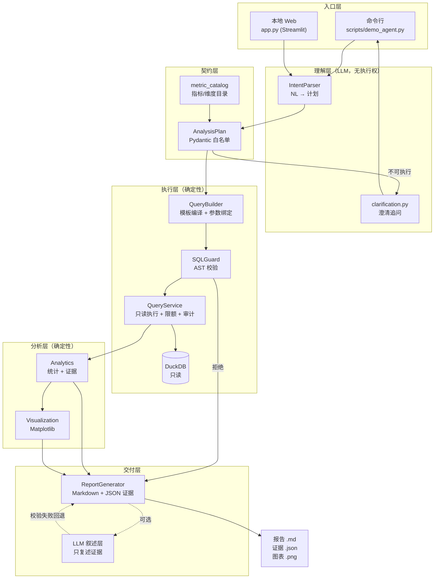
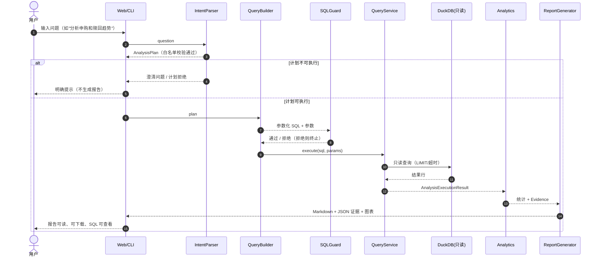
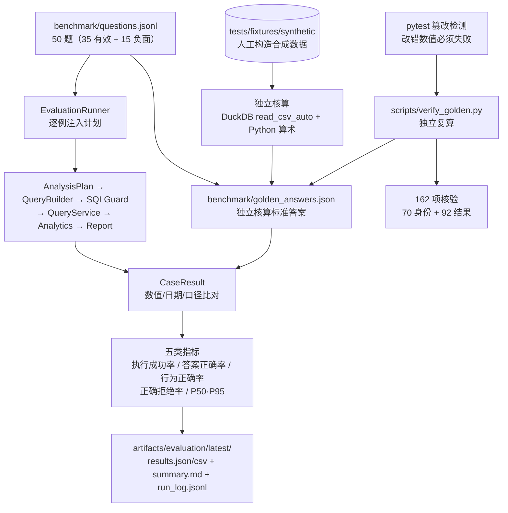
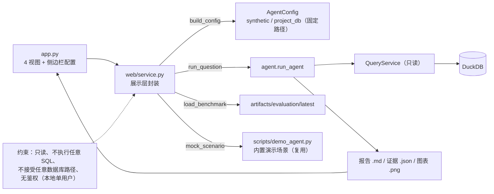

# 架构说明

> 本文描述 DataAgent **真实实现**的组件调用关系与数据流，所有 Mermaid 图在 GitHub 直接渲染。
> 未实现的能力（公网部署、多用户鉴权、k-匿名抑制）明确标注，不做预告性描述。

## 0. 五张核心图

### 0.1 Agent 整体架构



### 0.2 自然语言到报告的执行流程



### 0.3 SQL 安全边界（双层）

```mermaid
flowchart LR
    subgraph L1["第一层：SQLGuard（AST）"]
        A1["仅单条 SELECT（只读）"]
        A2["表白名单<br/>4 业务表 + 填充视图"]
        A3["函数白名单<br/>禁 read_csv/glob 等"]
        A4["禁 SELECT * 导出"]
        A5["user_id 仅聚合计数<br/>用户级金额列仅聚合"]
        A6["维度列必须 GROUP BY<br/>集合聚合一律拒绝"]
        A7["列-表静态绑定<br/>歧义/未知即拒"]
    end

    subgraph L2["第二层：QueryService（连接与执行）"]
        B1["只读连接"]
        B2["enable_external_access=false<br/>扩展自动加载关闭"]
        B3["参数化执行（值不拼接）"]
        B4["行数上限 1000 / 硬上限 10000"]
        B5["执行超时取消（interrupt）"]
        B6["审计：指纹/表/状态/耗时<br/>不含参数值与用户记录"]
    end

    SQL["待执行 SQL"] --> L1
    L1 -->|通过| L2
    L1 -->|拒绝| REJ["sql_rejected<br/>不执行"]
    L2 --> DB[("DuckDB")]
    L2 -->|异常/超时| ERR["execution_failed / timeout"]
```



### 0.4 Benchmark 与 Golden Answers 校验链路



### 0.5 Streamlit 与后端调用关系



## 2. 组件职责边界

| 组件 | 职责 | 明确**不做**的事 |
|---|---|---|
| `IntentParser` | 调用 OpenAI 兼容客户端，把问题解析为 `AnalysisPlan`（指标/时间/维度/筛选/统计操作，全部白名单） | **不生成 SQL**、不接触数据库、无执行权限；输出含 SQL 字段一律拒绝（Schema `extra="forbid"`） |
| `AnalysisPlan`（Pydantic） | 计划的结构与合法性：白名单校验、时间锚点、可执行性判定（`unresolved` 为空等） | 不执行任何查询 |
| `QueryBuilder` | 在封闭指标目录上把计划**编译**为 SQL：固定模板 + 参数绑定（`?`），仅两类已审核 JOIN（用户关联、日期关联） | 不接受用户指定表名/字段名/JOIN；用户输入绝不进入 SQL 语法 |
| `SQLGuard` | SQLGlot AST 校验：单条只读 SELECT、表白名单、函数白名单、禁 `SELECT *`、用户级数据保护、集合聚合拒绝、列-表静态绑定 | 不做语义/业务正确性判断 |
| `QueryService` | 只读连接、参数化执行、行数上限（默认 1000/硬上限 10000）、执行超时取消（`interrupt`）、结构化审计（不含参数与用户记录） | 不写库、不装扩展、不开外部访问 |
| `Analytics` | 确定性统计：日趋势与环比、三类极值分列、窗口对比全维度配对、排名占比、分布、稳健 MAD 异常、Pearson/Spearman；结果带 `Evidence` | 不连数据库、不生成 SQL、不做因果归因 |
| `Visualization` | Matplotlib（Agg）PNG：趋势/对比/排名/分布/相关性；中文字体检测与英文回退；失败隔离 | 不影响统计结果 |
| `ReportGenerator` | 14 节 Markdown + JSON 证据（`[E00x]` 双向对应）；复现元数据；可选 LLM 叙述层 | 不改写统计数值；LLM 失败不伪装成功 |
| `agent.py` | 编排：问题 → 计划 → 澄清判断 → SQL → 执行 → 统计 → 图表 → 报告；状态机（`ok`/`needs_clarification`/`plan_rejected`/`sql_rejected`/`execution_failed`/`timeout`/`insufficient_data`/`incompatible_metric`/…） | 不在编排层做统计或叙事决策 |

## 3. LLM 的权限边界（重点）

1. **LLM 只产出结构化计划**，且计划 Schema 封闭（`extra="forbid"`）：任何 SQL 字符串、额外字段、越权指标都在校验期被拒绝；
2. **提示词注入不会扩大白名单**：用户输入以不可信数据包裹（`<user_question>` 标签），指标/维度/操作集合来自代码常量；
3. **LLM 不能执行任意 SQL 或任意 Python**：执行链路只有 `QueryBuilder → SQLGuard → QueryService` 一条，且 SQL 由模板编译；
4. **LLM 叙述层只能复述证据**：数字白名单、证据 ID 引用、因果/口径表述均受校验；四类失败（API 失败、输出截断、完整性失败、证据不一致）**明确回退确定性文本**并在报告中记录原因，报告只呈现问题类别、不回显被拒内容；
5. **失败关闭**：澄清/计划拒绝/SQL 拒绝/超时/数据不足一律返回明确状态与原因，不生成“成功”报告。

## 4. 数据底座

### 4.1 默认数据流（公开仓库开箱即用）

```
demo_data/*.parquet（仓库自带，经授权脱敏的演示数据）
   │ scripts/build_demo_db.py --verify（先校验 SHA256SUMS.txt，再离线建库）
   ▼
data/processed/dataagent_demo.duckdb（本地生成物，不进 Git）
   ▼
QueryService（只读连接、行数上限、超时取消、结构化审计）
   ▼
Analytics（口径校验 + 统计）
   ▼
Chart / Report（图表 + 中文报告）
```

- 默认入口：`python scripts/build_demo_db.py --verify` → `data/processed/dataagent_demo.duckdb`；
- 4 个 Parquet 与 `demo_data/SHA256SUMS.txt` 随仓库发布；构建前**严格校验**（清单缺失/重复/缺项/多项/哈希不符均失败关闭）；
- 生成的 DuckDB 为本地产物，**不进入 Git**、不随仓库二进制发布。

库内表：

```
dataagent_demo.duckdb
   ├── user_balance_table      资金流水（用户 × 日）
   ├── user_profile_table      用户画像（city/sex/constellation）
   ├── mfd_day_share_interest  每日收益率
   ├── mfd_bank_shibor         SHIBOR（仅工作日）
   └── v_mfd_bank_shibor_daily_filled  分析视图（LOCF 前向填充 + 来源追溯）
```

- SHIBOR 仅工作日观测（294/427 天）；分析视图按 LOCF 填充并保留 `source_obs_date`/`is_filled`，**不覆盖原表**。

### 4.2 可选高级用法：从原始 CSV 构建

> **原始 CSV（`Purchase Redemption Data/`）不随公开仓库发布**；仅当拥有授权原始数据时使用。

```
原始 CSV（Purchase Redemption Data/，只读、本地私有，不随仓库发布）
   │ ingestion.py：流式校验 + 导入（日期 YYYYMMDD → DATE；金额整数元）
   ▼
DuckDB（如 data/processed/dataagent.duckdb，本地生成物，不进 Git）
```

- 构建与审计入口：`scripts/build_database.py`（含覆盖保护）、`scripts/audit_database.py`（契约/恒等式/填充逐格验证）；
- 该流程为**可选的高级使用方式**：面向拥有授权原始数据的维护者；默认交付形态与 CI 均使用 4.1 的 Parquet → 演示库流程。

## 5. 安全与隐私机制（实现现状）

| 层 | 机制 |
|---|---|
| 计划层 | 白名单指标/维度/操作；类别字段仅 `eq/ne/in`；期限参数白名单；筛选值形状校验；可执行性判定 |
| SQL 生成层 | 模板 + 参数绑定；无用户指定表/字段/JOIN；生成后 `sql_guard` 静态预检 |
| SQL 校验层 | AST 级：单条 SELECT、只读、表白名单、函数白名单、禁外部访问、禁 `SELECT *`、`user_id` 仅聚合计数、用户级金额列仅聚合、维度列必须 GROUP BY/聚合、集合聚合拒绝、列-表绑定 |
| 执行层 | 只读连接；外部访问/扩展自动加载关闭；行数上限；超时取消；并发串行化 |
| 统计层 | 请求指标必须唯一对应结果列（缺失/多口径 → `incompatible_metric`）；零基数不输出无穷大；缺失不补零；缺组不视为 0 |
| 报告层 | 证据 ID 双向对应；模式标识（Mock/合成 ≠ 真实）；复现元数据（有效运行配置，不含密钥） |
| **披露控制（未实现）** | **k-匿名/最小分组规模抑制未实现**；细粒度统计存在小样本披露风险；**不提供正式统计披露控制保证**；相关性不代表因果 |

## 6. 状态机与失败语义

`run_agent` 的状态不是“成功/失败”二元，而是显式多态：`report_generated` / `report_generated_with_warnings` / `needs_clarification` / `plan_rejected` / `sql_rejected` / `execution_failed` / `timeout` / `insufficient_data` / `incompatible_metric` / `llm_not_configured` / …。任一环节失败都会中止后续链路并返回原因；演示脚本中的失败场景（不支持的指标、需要澄清、数据不足）即用于固化该行为。

## 7. 测试策略

- **合成优先**：默认测试全部基于 `tests/fixtures/synthetic/`（人工构造小样本），克隆即可运行，无需真实数据与 API Key；
- **Mock/Fake 客户端**：自然语言与叙述层测试不发起网络调用；
- **集成测试隔离**：真实数据验证带 `integration` marker，数据缺失时自动跳过；
- **不变性**：测试内置原始数据 MD5 与数据库行数不变性断言；
- 规模：**892 项**（阶段 13 当前记录）；干净克隆环境会跳过真实数据类测试。历史阶段数字（810/831/845/855/874）仅为各时点记录，不是当前总数。

## 8. 评测体系（阶段 11）

离线 Benchmark：50 道固定问题 + 独立核算的标准答案，逐例注入对应 Mock 计划，真实经过 `AnalysisPlan → QueryBuilder → SQLGuard → QueryService → Analytics → ReportGenerator`；输出查询成功率、答案正确率、正确拒绝率与响应时间分位。该结果衡量的是**确定性执行链路**，不代表真实模型的自然语言理解准确率（真实模型评测需显式启用，见 `docs/benchmark.md`）。

## 9. Web 层（阶段 12，本地单用户）

`app.py` + `web/service.py` 是**展示层**，不复制任何分析逻辑：

```
Streamlit 页面（app.py）
   │  侧边栏：模型模式 / 数据模式（仅 synthetic | project_db，固定路径）
   ▼
web/service.py
   │  build_config()  → AgentConfig（不接受任意数据库路径）
   │  run_question()  → run_agent()（内部 QueryService 只读连接）
   ▼
dataagent 后端（IntentParser → QueryBuilder → SQLGuard → QueryService → Analytics → Report）
```

约束：

- 数据库始终**只读**；页面**不能**执行或编辑 SQL（SQL 仅以参数化模板展示）；
- Mock 模式复用 `scripts/demo_agent.py` 的内置演示场景，**不代表真实语言理解**；
  未匹配到场景时明确提示，而不是假装理解；
- 每次分析仅在用户点击「运行分析」时触发；页面刷新不会重复调用模型；
- 报告/证据/图表与后端生成结果**同源**（直接读取后端产物文件），页面不重新计算；
- 本页面为本地单用户演示，**无鉴权、无会话隔离**，不适用于公网多用户场景。

## 10. 已知边界

**已实现**（避免与下文混淆）：命令行与**本地单用户 Streamlit 界面**（`app.py`，阶段 12）、
离线 Benchmark + Golden Answers 独立核验（阶段 11–13）、CI 工作流文件（`.github/workflows/ci.yml`）。

**当前仍存在的限制**：

- 分布统计与窗口对比仅支持单指标；
- DuckDB 无硬性 CPU/IO 配额（以超时取消 + 行数上限 + 连接参数控制）；
- **真实模型未在本仓库的自动化中验证**：真实调用路径由 Mock/Fake 覆盖协议层，
  真实效果需负责人按 `docs/real_web_acceptance.md` 手工验收；
- **k-匿名 / 最小分组规模抑制未实现**：细粒度分组（计数很小）存在披露风险；
- **无公网鉴权、无多用户隔离、无限流**：Web 界面仅限本地单人使用，不适用公网部署；
- 不提供任意 SQL 执行、任意数据库路径访问（仅合成库或项目固定路径，且始终只读）；
- CI 工作流文件已就绪，但**尚未在 GitHub 远端实际运行验证**。
